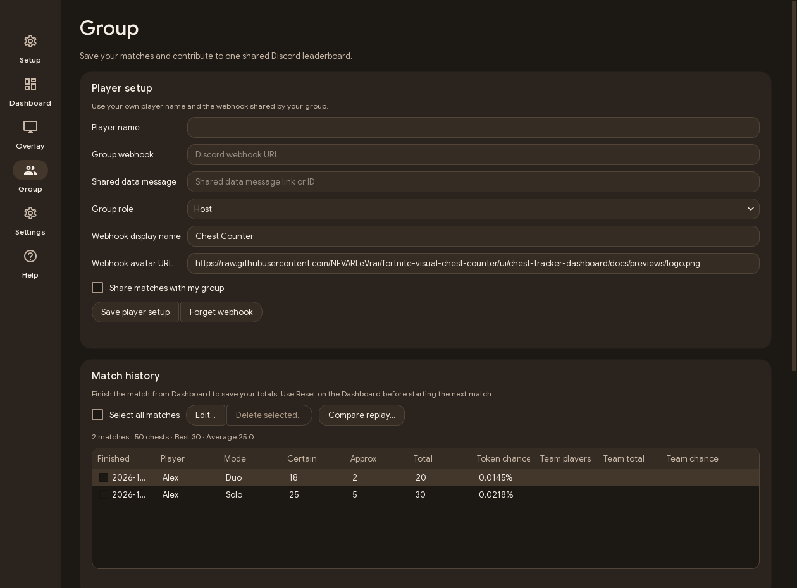

# Matches and Discord

## Your local match

Choose one source in **Dashboard → Capture settings**. To track manually, reset before the match, start counting and use **Finish match** to save it. **Group → Match history** lets you edit saved counts and delete checked rows. **Select all matches** checks every row. Local edits and deletions affect the history on your PC. Already shared results stay in the shared standings.

**Settings → Match automation** is enabled by default. It reads new entries in `%LOCALAPPDATA%\FortniteGame\Saved\Logs\FortniteGame.log`. Battle Royale warmup resets and starts the count. A return to the lobby stops counting and saves the result. The last result stays visible until the next match. For a match already underway when the app opened, use the manual controls.

The Dashboard mode selector defaults to **Auto**. It reads the Battle Royale playlist from the same log, independently of automatic start and finish. You can select **Solo**, **Duo**, **Trio** or **Squad** manually. The Pirate Token multiplier is manual. Unrecognised playlists may need manual mode selection.

## Share with teammates

1. Each player runs their own app and capture. In **Group → Player setup**, save a distinct player name and the same **Group webhook**. The URL identifies the collection channel. Share it privately.
2. Choose **Host** on the PC running the bot and **Guest** on the other PCs. Enable **Share matches with my group** on the PCs that should contribute.
3. The Host starts the bot, chooses a **Leaderboard channel** and clicks **Publish leaderboard**. The dropdown lists text channels where the bot can view the channel, send messages and embed links.
4. The Host uses **Copy sync ID**. Guests save that value under **Shared data message**. This feed message lets Guests read the same group data without receiving the bot token.

The collection webhook and the public leaderboard have separate jobs. Submissions go to the webhook's feed channel. The bot can publish the visible board in a different channel. Publishing again in another channel moves the tracked board there. A channel permission failure leaves the previous publication available for retry.

Guests with sharing enabled follow the Host's published mode and boost. Turning sharing off keeps new matches local and restores the Guest's personal controls. A Guest can read the last published data when the bot is offline. New contributions need the bot online before they appear in the shared data.

## Live sessions and history

Live sharing applies to a local Battle Royale match with a verified session fingerprint. The app queues the latest counts about every five seconds, coalesces unsent changes and updates the same live webhook message. A saved match supplies the final result. Retries update that player's result instead of adding the same chests again.

Matching Fortnite session fingerprints group teammates even when they leave at different times. The app sends the fingerprint, player name, confidence counts and boost, rather than the raw Fortnite log. Team membership is based on received submissions from that session. Players in another match stay in their own session.

The history keeps your personal counts. For a verified shared match with another submitted player, it also shows **Team players**, **Team total** and **Team chance**. Those extra columns stay empty for private or unverified matches and when no teammate has contributed. An incomplete team total includes only received counts.

## Bot setup and permissions

1. In the [Discord Developer Portal](https://discord.com/developers/applications), create an application and enable **Message Content Intent** under **Bot**.
2. In **Group**, open **Bot Discord**, save its Application ID and token, then use **Invite bot**. The invitation requests zero guild-wide permissions.
3. In the webhook's collection channel, grant **View Channel** and **Read Message History**. In a public leaderboard or report channel, grant **View Channel**, **Send Messages** and **Embed Links**.
4. Click **Start bot**. The badge reports its connection state. Enable **Start bot with the app** to connect at app startup.
5. In **Match reports**, choose manual sending or enable automatic reports for newly saved shared matches.

## Bot profile, webhook identity and presence

The bot profile and the webhook sender identity are configured separately. With the bot online, choose a bot name and an optional local PNG or JPEG avatar, then use **Apply** to update the bot account. This changes its profile across the servers where that bot is installed. Leaving the image empty uses the app's chest icon.

The webhook can use its own display name and image URL for outgoing messages. Its avatar is an HTTPS image URL, rather than a local image file. This sender identity is attached to the webhook messages.

While the bot is online, its presence rotates about every 30 seconds. When a current verified team session has recent live submissions, it shows team players and chests, then the team Pirate Token estimate. Saved group totals and match counts can appear in the rotation too. The text reflects received data. In **Bot presence**, choose Watching, Playing or Listening, edit each activity template, enable or disable rotation and set its interval from 30 to 300 seconds. Templates accept {total}, {players}, {matches} and {chance}. Use **Save profile and presence** to apply these preferences.

Bot and webhook credentials are stored in Windows Credential Manager.

| Command | Action |
|---|---|
| `/chests` | Show shared totals, or a player's stats. |
| `/leaderboard` | Show the same full ranking format as the published board. |
| `/leaderboard publish:true` | Publish or move the tracked live board to this channel. Requires Manage Server. |
| `/add` | Correct a player's total. Requires Manage Server. |
| `/reset` | Reset a player's standing. Requires Manage Server. |

Commands work in the configured server wherever Discord allows them. From **Group**, the Host can also reset checked players or delete the published leaderboard. Saved local match history is managed separately.

[Chest Tracker setup reference](https://github.com/Xxoris190/chest-tracker#set-up-the-discord-bot)
