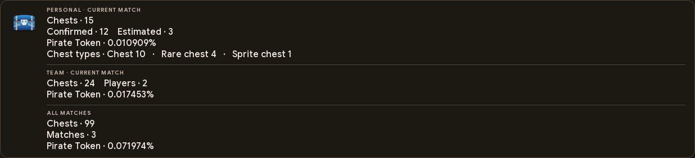

# Show the numbers on stream (OBS overlay)

The counter writes its numbers to a text file; an OBS **Text** source shows that file on your stream. You style the text
in OBS as you like. Same steps for every setup - on a dual-PC setup, do this in OBS on the streaming PC.

## On-screen overlay

Enable the on-screen overlay in **Overlay** and apply your changes. Enable **Visible when sharing your screen** to include it in Discord screen sharing. The **Transparency** slider controls its opacity, and the preview shows the current wording and statistics.

The overlay can show three scopes in order.

| Scope | Counts and estimate |
|---|---|
| Personal | Your current match, with the selected count layout and Pirate Token estimate. |
| Team | Submitted counts for the same verified session, shown when a teammate has contributed. |
| All matches | Your local saved matches and the current counter, with linked team sessions counted once. |

Each on-screen section has its own heading and multiline content editor. You can rename the Personal, Team and All matches headings and change which values each section shows. The All matches section includes the total match count.

| Placeholder | Value |
|---|---|
| `{total}` | Chest total for the section. |
| `{certain}` | Confirmed openings. |
| `{approx}` | Additional estimated openings. |
| `{chance}` | Estimated Pirate Token percentage. |
| `{players}` | Submitted players in the verified team. |
| `{matches}` | Match count for the cumulative section. |
| `{types}` | Available chest-type breakdown. |

For example, an All matches heading can use the content below.

```text
{total} chests across {matches} matches
Pirate Token · {chance}
```

The Personal section shows your live counter. The Team section appears when a teammate has contributed to the same verified session. The All matches section combines the known history and current counter. Use the preview to check the text before applying it. Legacy count wording for OBS continues to use `#`, `#C` and `#A` where offered.

The cumulative estimate preserves the boost used in each match. For `nᵢ` chests at per-chest probability `pᵢ`, it uses `1 − ∏(1 − pᵢ)ⁿᵢ`. Solo matches use your personal counts. Verified shared sessions use received team counts once, including your own contribution. A delayed result updates that session's total.

Team totals can be partial while a player's app or the bot is disconnected. No teammate count is invented. See [live sharing](matches-and-discord.md#live-sessions-and-history).



## Add the Text source

1. Open the scene your **viewers** see (not `ChestDetectorFeed`).
2. **Sources** -> **+** -> **Text (GDI+)** -> name it -> OK.
3. Tick **Read from file**, click **Browse** and choose **`obs_output\chest_counter.txt`** in the app's folder. The app's
   **Overlay** page shows the exact path; **Copy path** puts it on the clipboard.
4. Choose font, size and colour -> OK.

That is the only file you ever point OBS at. The counter rewrites it the moment a chest is counted; OBS re-reads the file
about once a second, so the text on stream changes within about one to two seconds. For instant updates, see
[OBS WebSocket](#instant-updates-obs-websocket-optional) below.

## Choose what viewers see

The app's **Overlay** page:

- **What OBS shows:** both numbers on two lines, both on one line, the estimated total only, or confirmed chests only - each
  with an example using your current numbers.
- **Wording:** `#` is where the number goes (`Chests opened: #`, `Chest Hunt: #/500`). For one line, `#C` = confirmed and
  `#A` = estimated total. **Restore wording defaults** restores the defaults. Any text, symbols and emoji work (with an OBS font that
  has them).
- The **on-screen preview** shows the floating overlay. **Apply** saves the settings and refreshes the OBS text.
- The OBS text uses the legacy APPROX total, which includes confirmed openings. The on-screen overlay uses
  the Dashboard split between confirmed and estimated-only openings.

The app cannot hide a Text source you already added in OBS: if a number on stream looks wrong, that source probably reads
another file.

## Instant updates: OBS WebSocket (optional)

Instead of OBS reading the file, the app can put the same text straight into your Text source through OBS's built-in
WebSocket server (OBS 28 or newer). Updates show at once, and the source needs no file path. The text file is still
written either way - nothing else changes.

1. In OBS: **Tools > WebSocket Server Settings** > tick **Enable WebSocket server** (port **4455**). Leave
   **Enable Authentication** on and click **Show Connect Info** to see the password.
2. In the app: **Overlay** page > **OBS WebSocket** > tick **Update a Text source in OBS directly**, paste the password,
   click **Connect**.
3. Pick your **Text source** in the list (Refresh lists them). Use a Text source **without** "Read from file" - or, if it
   reads the file, click **Use direct updates** (the app never changes that setting by itself).

The status line says what is happening: *Connected* (updating), *Waiting for OBS* (OBS closed - the app keeps trying and
catches up with the current numbers when OBS is back), *Password problem*, and so on. A renamed source is followed
automatically; a deleted one is reported.

- **Password:** kept in Windows Credential Manager, never in `config.toml`, a log or the diagnostics report.
  **Forget password** removes it.
- **What the app may do in OBS:** it only lists inputs, reads one source's settings and sets that source's text. It
  cannot start or stop your stream, change scenes or anything else.
- **OBS on another PC:** enter that PC's IPv4 address instead of `127.0.0.1` and allow TCP port 4455 in its firewall.
- **Do not let two tools update the same Text source** (for example an older counter script and this app): the last one
  wins and the text flickers. Give each tool its own source.

## Advanced: `config.toml` and the other files

The OBS WebSocket settings are in `[obs_websocket]` (`enabled`, `host`, `port`, `source`, `source_uuid`).

In `config.toml`, section `[display]`: `show = "both" | "certain" | "approx"`, `both_layout = "stacked" | "inline"`,
`certain_text`, `approx_text`, `combined_status_format` (`{count}` = the number; `{certain}` / `{approx}` anywhere; `\n` = new
line; `{{` / `}}` = literal braces), `use_thousands_separator`.

For separately styled sources the counter also writes:

| File in `obs_output\` | Contains |
|---|---|
| `chest_counter.txt` | **the one to use:** whatever the Overlay page chose |
| `chest_status.txt` | legacy: one line with both numbers (or the single number chosen) |
| `certain_chests.txt` | always the confirmed number |
| `approximate_chests.txt` | always the estimated total |
| `last_chest.txt` | the most recent chest, e.g. `CHEST +1 • HIGH` |

Opening the app writes your saved numbers back into these files, so the overlay is right before you start counting.
