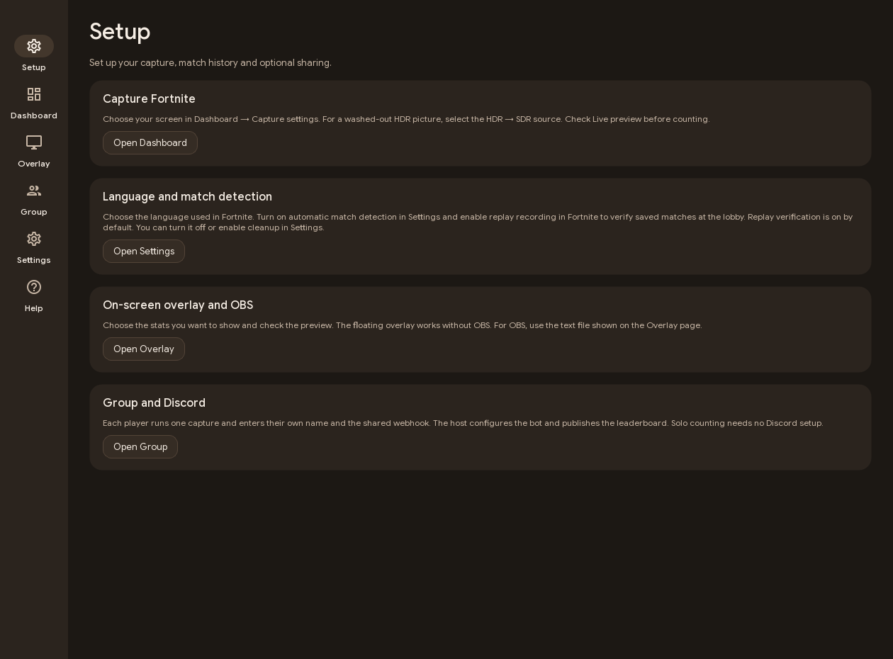
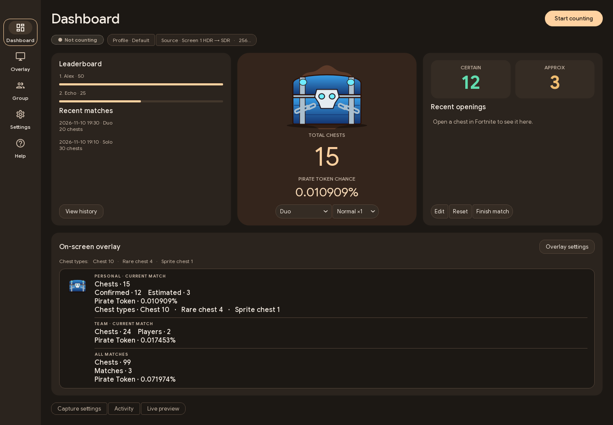
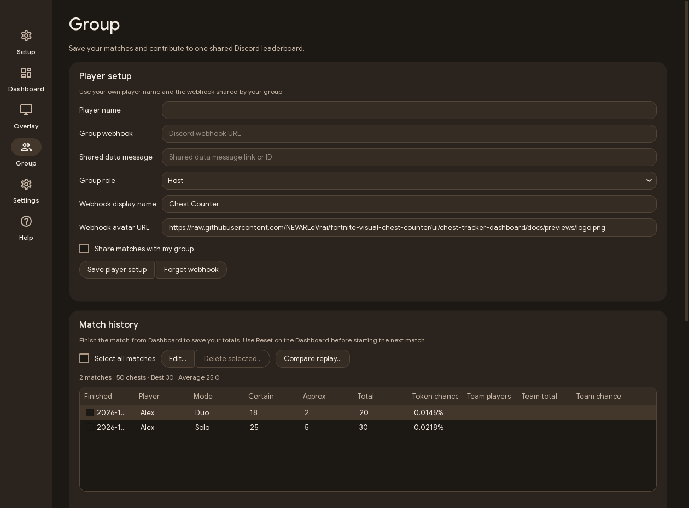
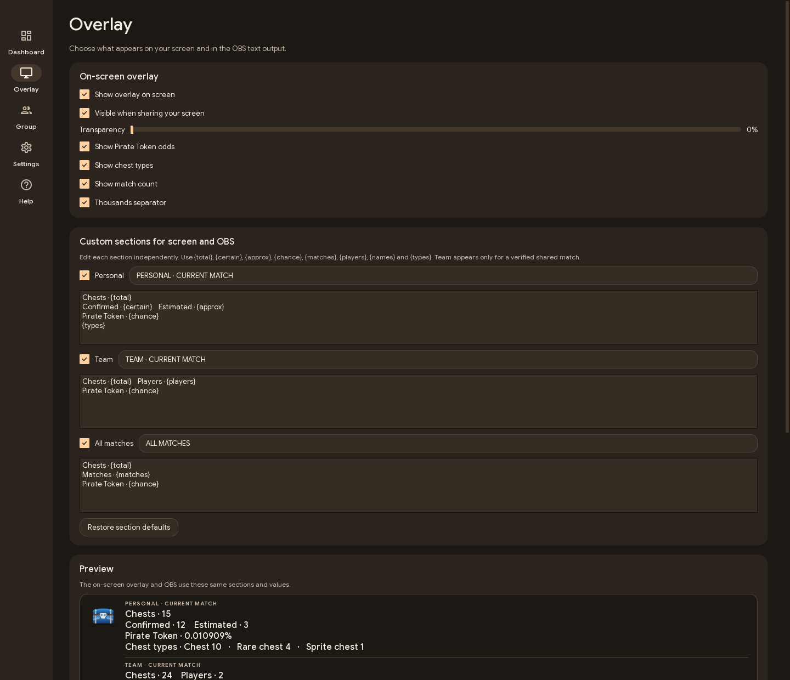
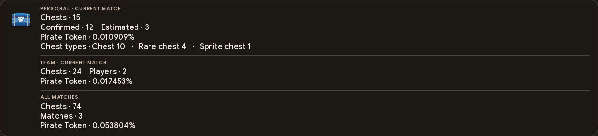
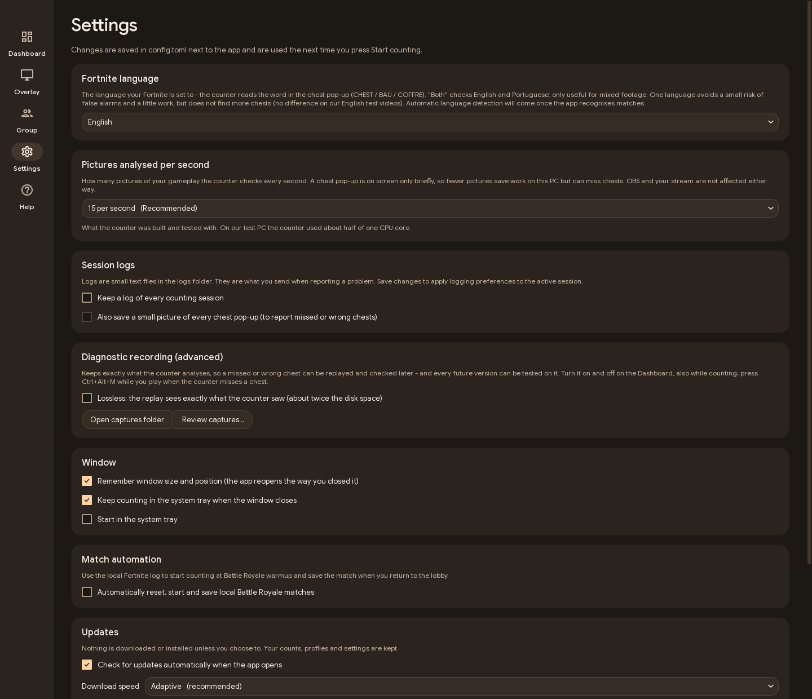
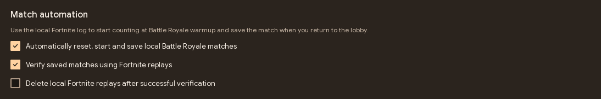
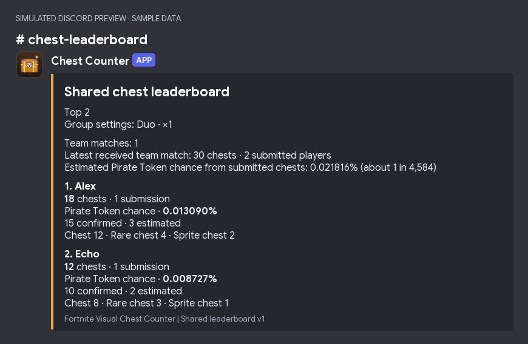
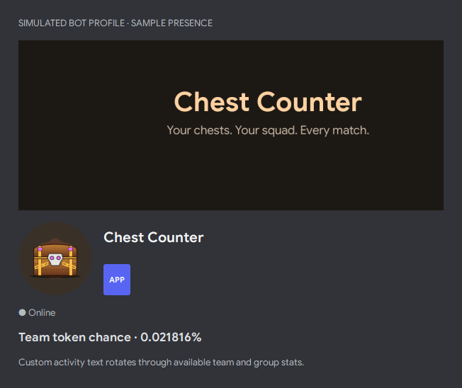
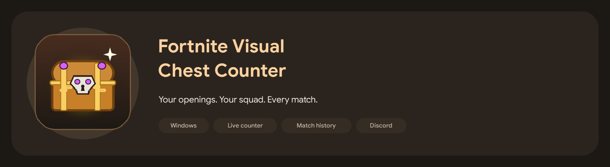

# App previews

These are captures of the application using sample data. Click an image to view it at full resolution.

## Setup

## Dashboard

## Group and match history

## Overlay settings

## Floating overlay

## Settings

## Discord simulations

These are local renderings of sample data. The leaderboard uses the app's embed payload.

## Artwork

The logo and banner reuse the app's chest illustration. See [acknowledgements](../ACKNOWLEDGEMENTS.md).

